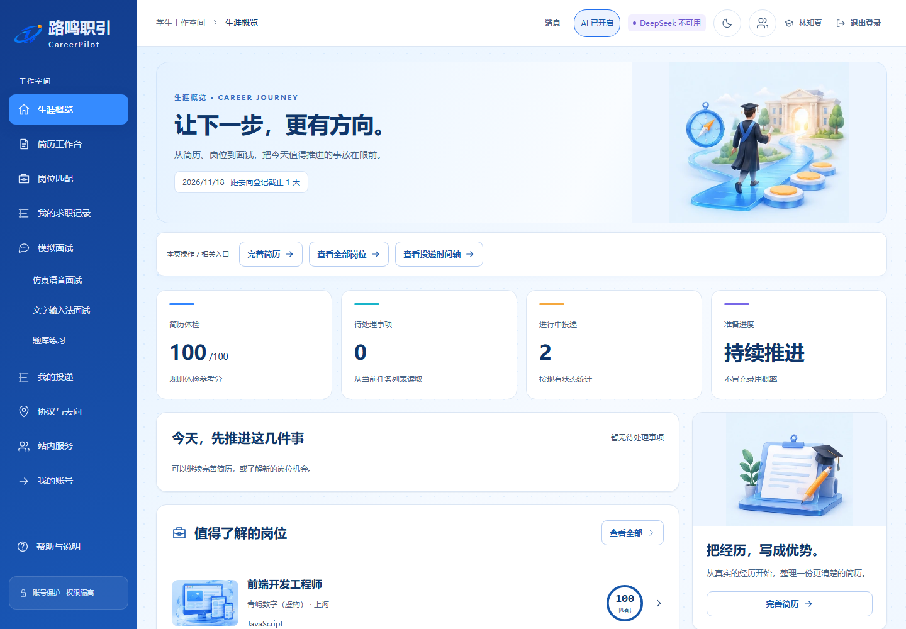

# 路鸣职引 CareerPilot

面向高校毕业生的就业管理与 AI 求职辅助 Web 应用，覆盖学生、企业、辅导员、管理员四类角色，将岗位发现、简历准备、求职投递、面试练习、协议去向与就业服务串联起来。

前端采用 **HTML5 + CSS3 + Vue 3 + TypeScript**，后端采用 Node.js / TypeScript 与 SQLite。AI 能力通过服务端调用 DeepSeek，密钥不进入前端。

> 本仓库为课程项目的完整源码与交付资料快照。当前主要运行方式是本机账号在线服务，不是已获公网生产放行的系统。GitHub 托管源码不等于部署应用；不要使用 GitHub Pages 承载账号、数据库或 AI 后端。

## 目录

- [界面预览](#界面预览)
- [功能与角色](#功能与角色)
- [技术架构](#技术架构)
- [快速开始](#快速开始)
- [AI 配置与使用边界](#ai-配置与使用边界)
- [项目结构](#项目结构)
- [测试与构建](#测试与构建)
- [文档与汇报材料](#文档与汇报材料)
- [安全、数据与部署](#安全数据与部署)
- [资源与许可](#资源与许可)

## 界面预览

以下图片来自实际应用渲染的隔离验收环境，采用合成账号与测试数据，不代表真实用户就业业绩；具体截图时间、来源、裁切与哈希见[素材清单](projects/careerpilot-ppt-brief-20261118/素材清单.json)。




## 功能与角色

| 用户 | 主要功能 |
| --- | --- |
| 公共访客 | 查看门户、搜索与筛选公开机会、浏览详情、跳转原来源 |
| 学生 | 生涯概览、简历与版本管理、预览导出、AI 优化、OCR 导入辅助、规则匹配与 AI 推荐、投递记录、文字/语音模拟面试、题库练习、面试报告、协议与去向 |
| 企业 | 岗位管理、候选人与投递处理、面试安排和日程、协议相关流程、企业工作台 |
| 辅导员 | 学生管理、就业概览、去向审核、预警与帮扶、统计查询 |
| 管理员 | 账号审核、来源与公开机会治理、系统概览、版本和审计相关管理 |
| 已获批账号 | 站内服务、账号管理、全局 AI 助手；具体操作仍受角色与数据归属约束 |

外部机会是可追溯来源索引，不代表本平台企业认证或站内投递；外部申请需要在原站完成。AI 助手提供解释与导航，不代替用户进行投递、审批或保存等业务操作。

## 技术架构

| 层次 | 实际技术与职责 |
| --- | --- |
| 页面与组件 | Vue 3、HTML 模板、自研 CSS、TypeScript、响应式页面与图文资源 |
| 路由与状态 | Vue Router（Hash 路由）、Pinia |
| 可视化与文档 | ECharts、PDF.js、浏览器打印/导出相关能力 |
| 构建与校验 | Vite、Ajv 预编译 Schema、ESLint、vue-tsc |
| 账号在线服务 | Node.js / TypeScript，同源 HTTP API、会话、权限与业务校验 |
| 在线数据 | SQLite、事务、revision 乐观并发、幂等操作 |
| 离线教学 | Dexie / IndexedDB，与在线库分离 |
| AI 工作台 | 服务端 DeepSeek 适配、SSE 文本输出、结构/引用校验、次数与并发限制 |
| 验证 | Vitest 单元与服务集成测试、Playwright 浏览器测试 |

正常在线链路为：浏览器页面 → 同源 `/api` → 权限与业务校验 → SQLite；需要 AI 的动作再由服务端访问 DeepSeek。确定性领域算法与 AI 生成分离，规则分数不能冒称模型评价。

`gateway/` 保留早期 Python / FastAPI 本机网关与相关测试，用于追溯及专项验证；当前账号在线模式不需要先启动它，也不要求为正常在线启动安装 Python。

## 快速开始

### 1. 环境要求

- 建议使用 **Node.js 24 LTS**；项目声明支持 Node.js `>=22.12 <25`、npm `>=10 <12`。
- Node 24 是账号在线 SQLite 服务的推荐运行环境；不要直接使用尚未验证的 Node 25/26。
- 推荐 Chrome 或 Edge。语音功能需要 localhost 或 HTTPS、安全上下文及麦克风授权。
- 首次安装依赖需要网络；真实 AI 功能另需有效服务端密钥与供应商额度。

### 2. 获取、安装与构建

```powershell
git clone https://github.com/lhh-lhh/careerpilot.git
cd careerpilot
npm ci
npm run build
```

请保留 `package-lock.json`，使用 `npm ci` 按锁定版本安装。不能直接双击 `index.html` 运行应用。

### 3. 仅全新安装：初始化账号在线服务

```powershell
New-Item -ItemType Directory -Path ./server-data -Force | Out-Null
npm run init:online -- --credentials-file ./server-data/initial-credentials.json
npm run start:online
```

打开 **http://127.0.0.1:4174/**。

初始化只适用于全新数据库，会为 `admin`、`teacher.lin`、`student.chen`、`student.li`、`hr.yuanxing` 生成各不相同的随机密码，保存到本机指定文件。它们分别覆盖管理员、辅导员、两名学生与企业角色。没有默认通用密码；本仓库不提供现有本机账号密码或实际运行数据库。安全保管账号表，首次登录后修改密码。

初始化提供通用字典和练习参考，不导入原电脑的真实业务、岗位与投递记录。当前本机后来添加的试运行账号及业务也不会随源码迁移。

**已有服务不要重新初始化，也不要用本仓库覆盖 `server-data/`。** 重复初始化会被拒绝；需要改密时由操作者本机执行 `npm run password:online`。

日常启动：

```powershell
npm start
```

Windows 也可在依赖和构建准备完成后双击 `start-service.cmd`。按 Ctrl+C 关闭本次服务。启动不会隐式初始化或重置数据库。

### 4. 离线教学与前端开发

```powershell
# 已完成构建后：本机离线教学，数据保存在当前浏览器
npm run start:demo

# 前端开发热更新
npm run dev
```

离线教学地址为 **http://127.0.0.1:4173/**；前端开发地址为 **http://127.0.0.1:5173/**。在线账号服务使用 **4174**。三者不是同一数据环境；切换 origin 会切换浏览器本地数据空间。`npm run dev` 不等于启动账号在线后端。离线模式不具备真实 AI 生成能力。

## AI 配置与使用边界

### 服务端配置

当前服务端读取 `CAREERPILOT_DEEPSEEK_API_KEY`，Windows 还支持当前 Windows 用户的项目外 DPAPI 加密配置。新电脑必须自行配置，原电脑的加密文件不能当作共享密钥分发。

参照 [.env.example](.env.example) 配置受控的进程环境变量。**当前 `npm start` 不会自动加载根目录 `.env` 文件**；请通过操作系统、进程管理器或本机安全凭据流程注入。不要把真实密钥写入示例、源码、命令截图或 Git 提交。

| 变量 | 默认/用途 |
| --- | --- |
| `CAREERPILOT_DEEPSEEK_API_KEY` | 无默认值；仅后端读取 |
| `CAREERPILOT_DEEPSEEK_MODEL` | `deepseek-flash`，以实际供应商支持情况为准 |
| `CAREERPILOT_AI_ENABLED` | 有可用密钥时启用；设为 `false` 禁用 |
| `CAREERPILOT_AI_DAILY_GLOBAL_CALLS` | `100`，全局每 UTC 日调用次数上限 |
| `CAREERPILOT_AI_DAILY_USER_CALLS` | `40`，每用户每 UTC 日调用次数上限 |
| `CAREERPILOT_DATABASE` | `server-data/service.sqlite` |
| `CAREERPILOT_HOST` | `127.0.0.1`，当前 CLI 仅允许 loopback |
| `CAREERPILOT_PORT` | `4174` |

### 已接入的使用方式

- 简历表达建议、优化草稿、人工采纳/撤销与保存新版本。
- 候选岗位 AI 推荐、理由解释，以及明确触发的公开资料搜索。
- 岗位化文字面试、语音面试、逐轮追问/评价与报告。
- 全局流式助手、本人会话历史、停止与删除。
- OCR 辅助识别 PDF / PNG / JPEG，结果需人工核对，不自动写入正式简历。
- TTS 语音播放与整段 ASR 转写；不是实时流式 ASR 或双工电话系统。

真实生成由用户点击触发，可能外发必要数据并产生费用；失败明确报错，不以模板、回放或规则输出伪装为成功 AI 结果。页面读取历史不会自动重新付费生成。关闭或取消不能保证撤回已发送数据、已产生费用。

次数额度不是金额预算；失败尝试和工具调用也可能消耗次数/余额，无自动付费重试。本次仓库发布不会调用付费 AI。JSON 与引用校验能降低结构性错误，但不保证模型事实完全正确；评分仅用于练习参考。

完整说明：[严格 AI 使用手册](docs/strict-ai-pet-runbook.md)、[AI 工作台运行说明](docs/ai-workbench-runbook.md)。历史文档中的 REPLAY/RULE 行为只代表当时阶段，不覆盖当前严格 AI 行为。

官方参考：[DeepSeek 文档](https://api-docs.deepseek.com/zh-cn/)、[Chat Completion](https://api-docs.deepseek.com/zh-cn/api/create-chat-completion)、[JSON 输出](https://api-docs.deepseek.com/zh-cn/guides/json_mode)。协议与可用模型会变化，以供应商最新文档及实际响应为准。

## 项目结构

```text
careerpilot/
├── src/                  # Vue 页面、组件、领域算法、服务层、路由、状态及样式
├── server/               # 账号服务、SQLite、授权、安全与 DeepSeek 工作台后端
├── public/               # 本地图片、品牌/场景资源、第三方动画与许可
├── tests/                # Vitest 单元/集成测试和 Playwright 浏览器测试
├── scripts/              # 构建、启动、验证、备份及受控运维脚本
├── gateway/              # 历史/专项 Python 本机网关与锁定依赖
├── docs/                 # 需求设计基线、运行手册、设计稿与分阶段验收证据
├── projects/             # PPT 设计材料、讲稿、实际页面/关键源码截图
├── presentation/         # 最终导航版 PPTX、演讲稿与可编辑汇报源文件
├── .env.example          # 无真实密钥的环境变量参考，不会自动加载
├── README.md
└── THIRD_PARTY_NOTICES.md
```

`node_modules/`、`dist/`、数据库、备份、私有账号表、真实密钥、测试缓存和重复 ZIP 不进入仓库。旧稳定版本与原始课程工程未重复上传，当前项目基线已保存在 `docs/baseline/`。

## 测试与构建

```powershell
npm run typecheck
npm run lint
npm run build
npm run test:unit

# 首次浏览器测试：安装所需 Chromium（需要网络）
npx playwright install chromium
npm run test:e2e -- --project=chromium

# 如本机已安装 Edge，可选择对应项目
npm run test:e2e -- --project=msedge
```

单元测试中含依赖 `dist/` 的交付包集成测试，因此先构建再运行完整测试。E2E 涵盖离线与隔离账号服务场景；请按测试配置准备端口与浏览器，不要擅自关闭其他人的服务。

```powershell
# 可选专项检查
npm run verify:contracts
npm run verify:seed
npm run test:online
npm run test:delivery
npm run test:perf

# 可选：构建离线演示包与源码包，输出 artifacts/release/
npm run build:release
```

专项真实 AI 脚本不是普通离线测试，需单独核对授权、外发资料与费用，不应作为无条件 CI 步骤。Python 网关测试需要另行准备其虚拟环境与锁定依赖。

仓库整理时的实际验证范围见[发布说明](docs/github-publication.md)与[验证记录](docs/evidence/github-publication-20261119.json)；旧验收报告保留当时范围，不代表所有浏览器、真机或公网部署均已通过。

## 文档与汇报材料

| 入口 | 内容 |
| --- | --- |
| [需求与设计基线](docs/baseline/README.md) | 需求、概要设计、数据/算法/AI 契约、课程要求与追溯 |
| [开发过程](docs/development-progress.md) | 分阶段实现和历史决策 |
| [运行与备份](docs/stage-three-runbook.md) | 一致性备份、恢复和运行边界 |
| [账号与权限](docs/stage-four-runbook.md) | 账号在线底座与运维 |
| [公开岗位来源](docs/stage-five-runbook.md) | 来源审核、公开机会与外链说明 |
| [验收证据目录](docs/evidence/) | 分阶段测试和限制，含历史失败/未执行项 |
| [汇报材料导航](presentation/README.md) | 最终 PPTX、讲稿与编辑源入口 |
| [PPT 详细设计稿](projects/careerpilot-ppt-brief-20261118/01-PPT详细设计文档稿.md) | 12 页主讲设计、文案与代码讲解重点 |
| [报告演讲稿](projects/careerpilot-ppt-brief-20261118/02-报告演讲稿.html) | HTML 阅读、字号与打印支持 |
| [关键源码截图](projects/careerpilot-ppt-brief-20261118/images/code/) | 14 张真实源码截图，带原路径与行号 |
| [应用界面截图](projects/careerpilot-ppt-brief-20261118/images/ui/) | 13 张实际页面截图/局部及对应素材清单 |

本地 HTML 请克隆/下载完整目录后打开；GitHub 通常只展示源码，不直接运行交互 HTML。设计材料中的 7 分 40 秒为建议预算，不代表所有后续 PPT 版本均已按本人实际彩排计时。

## 安全、数据与部署

- 不提交账号表、运行 SQLite、业务附件、录音、会话令牌、API 密钥、私有备份或 `.env`。见 [SECURITY.md](SECURITY.md)。
- 初始化数据、离线教学数据和隔离测试数据不是原电脑业务迁移包。
- 在线服务具有会话、CSRF、归属授权、密码哈希、账号审批与限流等保护，但不等于已通过外部安全审计。
- 当前 CLI 限制本机监听；公网运行需要单独完成 TLS、反向代理、密钥管理、隐私与合规、备份恢复、容量和安全验收，不建议直接绕过监听限制。
- 更新前做一致性备份；不要只复制运行中 SQLite 主文件，也不要覆盖现有数据库。恢复需使用全新目标目录并按运行手册切换。
- 物理麦克风、弱网听感、触屏与非 Chromium 兼容性、完整无障碍和公网容量不能仅凭历史自动化测试作保证。
- 如密钥曾在聊天、截图或其他公开位置出现，应先去供应商控制台轮换，再更新本机安全配置。

## 资源与许可

本项目包含原创代码、AI 生成场景图以及分别受许可约束的第三方资源，不能把整个仓库简单视为统一 MIT 授权。

- 动态助手素材来自 [PC2005-cloud/dsh-pet](https://github.com/PC2005-cloud/dsh-pet) 固定提交，代码与角色素材授权不同；角色/动画为 **CC BY-NC-SA 4.0**，限非商业并要求署名和相同方式共享。
- 该角色是社区二创，非 DeepSeek 官方形象或官方背书。商业部署需另获授权或替换素材。
- 图像来源、生成与处理记录见 `docs/media-manifest.json`、相关设计证据和 `public/vendor/dsh-pet/` 许可文本。
- 第三方依赖遵循各自许可证；项目自有部分尚未额外指定统一开源许可证，不自动授予再分发或商业授权。

完整声明见 [THIRD_PARTY_NOTICES.md](THIRD_PARTY_NOTICES.md)。
