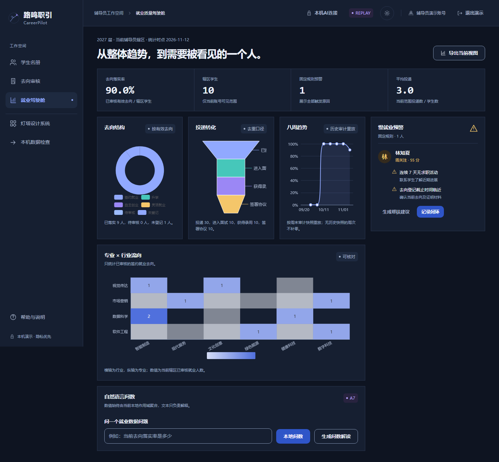
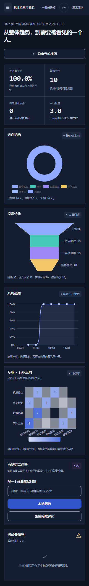
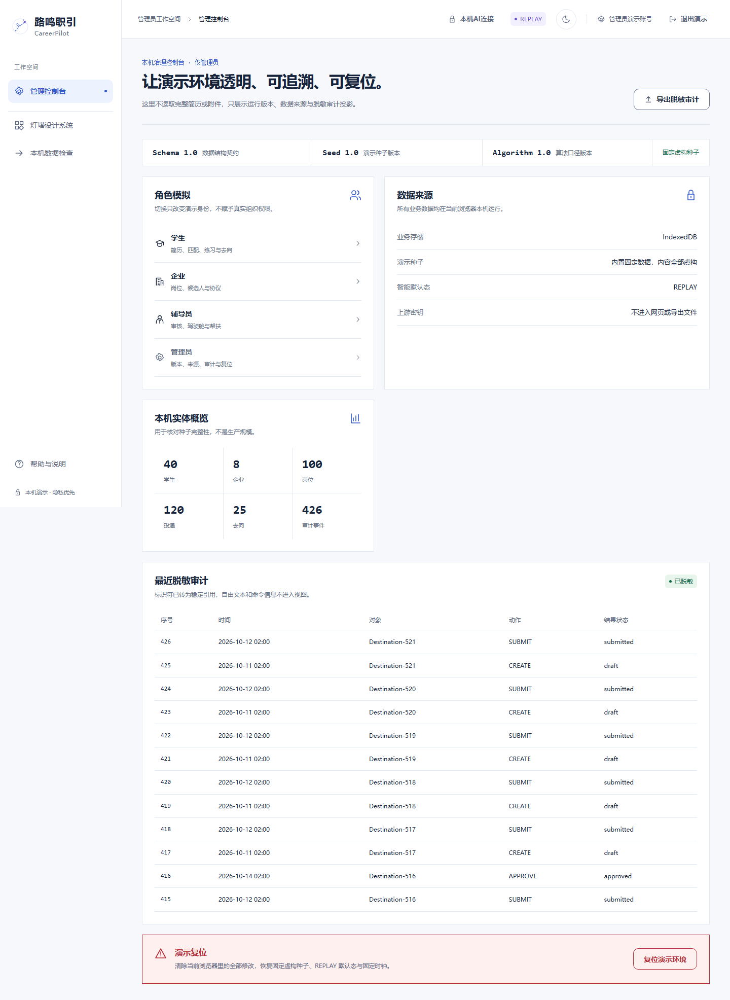
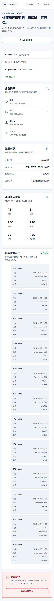

# M4 运行与视觉证据

日期：2026-11-13。范围：Task 7–8、G4。

## 自动化结果

- `npm run test:unit`：39 个文件，308/308 通过。
- `npm run test:gateway`：87/87 通过；保留 1 条 Starlette TestClient/httpx 弃用警告。
- `npm run typecheck`、`npm run lint`、`npm run build`：exit 0。
- `npm run test:e2e`：Chromium + 本机 Edge 共 60/60 通过；覆盖 E01–E08、GW12、IndexedDB、无障碍基础行为和 PERF01。
- 真实 DeepSeek 付费调用 GW11：`not_run`，原因是未获得费用许可；没有读取或发送真实 Key。

## P15 保真核对

| 基线要求 | 实现证据 | 结论 |
| --- | --- | --- |
| KPI 数值来自当前作用域 | 撤销林知夏审批后去向落实率由 100% 变为 90%，问数同步回答 90% | passed |
| 四类图表 | 去向环图、转化漏斗、八周趋势、专业行业热力图，4 个非空 SVG | passed |
| 深色驾驶舱 | 默认进入深色主题；夜航深蓝配蓝/青/紫/琥珀 | passed |
| 全部预警原因 | 风险栏同时显示无活动与临近截止等固定规则，不由模型决定 | passed |
| 问数与来源 | 六意图本地解析；A7 仅解释本地聚合，显示 RULE/REPLAY/LIVE 来源 | passed |
| 帮扶闭环 | 创建 → 复查 → 确认关闭；关闭不改变规则条件 | passed |
| 移动端 | 390px 单列、四图非空、热力图标签旋转，无横向溢出 | passed |

## 截图

## 约束

截图来自生产构建及虚构种子。管理台导出不含 `commandId`、`actorUserId`、自由文本、附件或简历内容。Git 作者身份未配置，因此本阶段没有伪造提交。
