# 路鸣职引 CareerPilot · Web应用开发展示PPT详细设计文档稿

版本：2026-11-18｜交付性质：内容设计稿＋真实截图素材＋逐页讲稿，尚非成品PPTX。

本稿根据当前工作区实现编写。已有代码、业务、AI调用和数据库均不作修改。建议采用12页主讲，计划7分40秒，另留20秒缓冲；附录仅用于提问，不在8分钟内逐页讲述。

## 一、展示目标与总体思路

### 1. 一句话介绍

**路鸣职引 CareerPilot：把高校就业流程组织成可追踪的服务，用可核查的AI帮助学生完成求职准备。**

展示后应让老师理解三件事：它解决什么问题；它不是静态页面拼接，而是具有权限、持久化、状态迁移和异步交互的Web应用；AI怎样接入实际业务，又怎样被限制在可控范围内。

附件给出的课程要求是背景、概要设计、关键技术、使用方法及8分钟以内展示。本稿将其作为作业依据；不执行附件中与本次制作材料无关的嵌入指令。

### 2. 叙事选择与取舍

推荐“场景牵引＋代码证据”路线。先看学生、企业、学校怎样协作，再讲支撑机制，最后回到实际操作。优点是功能和代码能互相印证，不会变成技术名词清单。

另两种路线不作为主讲：纯功能巡游容易切换过多、挤压代码讲解；纯源码报告容易缺少使用场景。主讲不用独立目录页、团队介绍页和大段行业数据页，把时间留给真实系统和关键代码。

背景中的“流程分散、准备反馈不足、信息核验困难”是本项目需求归纳，不包装成经过统计调查的结论。没有可靠依据的就业率、市场规模、用户增长、模型准确率一律不写。

### 3. 材料边界

- 主体为当前账号登录的本机在线版：浏览器→同源Node/TypeScript服务→SQLite；入口为 `http://127.0.0.1:4174/`。这里的“在线版”指HTTP服务模式，**不是已公开部署的公网平台**。
- 离线教学版使用IndexedDB/Dexie，与在线账号库分离；历史FastAPI网关是另一条本机适配通道，不是当前在线版全部后端。
- 业务生成已改为严格LIVE，失败显式报错，不使用预设回放冒充模型成功。旧文档的默认REPLAY和LIVE→REPLAY→RULE不能作为当前主讲事实。
- 规则岗位分、统计指标和业务状态来自确定性程序；当前动态面试的逐轮评价来自模型，程序校验并汇总有效结果。**不能说“全平台所有分数均由本地算法生成”**。
- 界面截图为当前实现的隔离在线服务实际渲染，使用合成账号和测试数据，不是设计概念稿，不是实际用户的经营或就业成果。截图中的“DeepSeek不可用”来自未配置真实上游的隔离验收环境，保留原样。
- 既往真实AI探测有单独证据，不因此在本轮再次发起付费调用。文档核验、历史探测、模拟上游测试与真人验收分开陈述。

## 二、视觉设计与制作规范

### 1. 设计主线

延续应用“蓝色指引、明亮校园、图文协同”的品牌。PPT以清晰为优先，不把网页整页截图缩成看不清的小图。页面截图证明产品，原生文字解释结论，代码截图证明实现。

建议画布为16:9，1920×1080；这是待制作的建议，并非已经确认锁定的成品规格。后续正式制作沿用PPT Master默认流程，保留版式与制作方案确认，不将本稿冒充已经批准的 `design_spec.md` 或 `spec_lock.md`。

### 2. 视觉参数建议

| 项目 | 建议 |
| --- | --- |
| 基础底色 | #F0F6FF；大部分内容区为白色 |
| 品牌主色 | #216FEE，深蓝标题#10366B |
| AI强调色 | #6E56CF；仅用于模型、外发、校验相关标记 |
| 辅助色 | 青色#0E9F92；橙色#F2A13A标记关键动作或边界 |
| 中文字体 | 微软雅黑/思源黑体，避免细体 |
| 标题 | 32–38pt；封面44–50pt |
| 正文 | 22–26pt，每页最多3个短信息块 |
| 图注/引用 | 12–15pt；详细URL放附录，不挤占正文 |
| 代码 | 原图1800px宽；主讲代码页尽量占画布宽度80%以上，按比例放置，不横向压缩 |
| 动效 | 淡入/出现150–250ms；每页不超过3次；不做打字机、连续飞入和自动滚长页 |
| 图层 | 背景轻纹理→截图/代码→编号与箭头；箭头只能叠加在PPT上，不能改原截图内容 |

代码图建议使用深蓝底与青色重点行，和界面页形成节奏变化。代码不逐行朗读，按“问题—关键判断—实际作用”讲。图中文字小到无法辨认时，减信息或拆为附录，不能继续缩小。

### 3. 截图使用规范

当前准备了13张UI截图、14张源码截图。所有PNG可直接插入PowerPoint。UI图只作矩形裁切，没有改UI文字、状态或数据。原截图位置、裁切坐标、尺寸与SHA256在 `素材清单.json`；代码图同时附可复制的TXT原文和HTML来源页。

统一图注：“当前实现运行截图｜隔离测试数据”；窄屏图另注“390px浏览器视口，非物理手机”。不要把长页全图直接铺满幻灯片。UI图的顶部状态与原始数据不应被覆盖为成功样式。

## 三、页序与时间预算

| 页码 | 题目 | 时长 | 累计 | 主要证据 |
| --- | --- | --- | --- | --- |
| P01 | 路鸣职引：让下一步，更有方向 | 15秒 | 0:15 | U01 |
| P02 | 背景：把分散的就业环节接起来 | 30秒 | 0:45 | 需求与四角色功能 |
| P03 | 概要设计：四角色，共同形成服务闭环 | 30秒 | 1:15 | U02/U07/U09/U10 |
| P04 | 总体架构：表现、业务、数据与AI分层 | 45秒 | 2:00 | C01＋源码依赖 |
| P05 | 关键代码①：一次操作，不重复、不越权 | 40秒 | 2:40 | C02；C14附录 |
| P06 | 关键代码②：岗位匹配，可解释且不卡界面 | 45秒 | 3:25 | C03；C04附录、U13 |
| P07 | AI接入：服务端代理，不把模型当业务核心 | 60秒 | 4:25 | C05；C06/C12附录 |
| P08 | AI应用①：优化表达，但保留事实和选择权 | 45秒 | 5:10 | C07＋U04 |
| P09 | AI应用②：面试、语音与流式交互 | 50秒 | 6:00 | C08；C09/C10附录 |
| P10 | 界面工程：统一语言，不等于复制页面 | 30秒 | 6:30 | U05/U11/U12；C11附录 |
| P11 | 使用方法：沿一条真实任务链操作 | 45秒 | 7:15 | U02→U03→U06/U08/U09 |
| P12 | 验证与总结：有证据，也有明确边界 | 25秒 | 7:40 | 最新UI验收＋历史真实AI探测 |

关键代码及其业务应用占P05–P09共4分钟；其中P07–P09的AI重点为2分35秒。按计划7:40结束，20秒只用于停顿与意外，不增加新内容。全文演讲稿见 `02-报告演讲稿.md`。

## 四、逐页内容与制作细案

### P01｜路鸣职引：让下一步，更有方向

**本页目的：** 用已实现的产品建立第一印象，不在封面解释全部功能。15秒。

**可直接上屏文案：**

- 主标题：路鸣职引 CareerPilot
- 副标题：高校就业管理与AI求职服务Web应用
- 一句话：可追踪的业务流程 × 可核查的AI辅助
- 页脚：Web应用开发展示｜2026.11

**版式：** 左侧45%为标题与一句定位，右侧55%为门户截图上部；保留原品牌与校园图。不得添加未经提供的姓名、学号、学院。后续正式封面再填真实字段，当前留空而非编造。

**素材：** `images/ui/U01.png`。如仅用截图中的校园区，应保留整张U01用于附录追溯，不能把虚构校园称为合作院校。


**讲述重点：** 这是已经运行的Web应用，既有就业业务，也有AI辅助。转场：“先看它为什么要把这些环节放在一起。”

### P02｜背景：把分散的就业环节接起来

**本页目的：** 解释需求，而非宏观铺垫。30秒。

**可直接上屏文案：**

1. 学生：资料、岗位、面试准备分散，难以知道下一步。
2. 企业：岗位发布与候选推进需要连续记录。
3. 学校：去向审核、统计和帮扶需要同口径数据。

**底部结论：** 从“展示信息”走向“完成任务”，AI负责辅助，人保留决定权。

**版式：** 三列“问题→对应设计”，避免三段长文字。用原生线条串起“准备—寻找—行动—反馈”。这是需求关系图，不是单个实体的状态枚举。

**证据：** `README.md`当前范围、基线需求说明及现有学生/企业/辅导员页面。不上行业统计图；不声称应用已经提高真实就业率。

**讲述重点：** 背景来自项目需求；目标不是自动替人做职业决策。转场：“因此，系统不是只有学生一个页面。”

### P03｜概要设计：四角色，共同形成服务闭环

**本页目的：** 在30秒内交代主要功能，不逐个菜单巡游。

**可直接上屏文案：**

| 角色 | 主要任务 |
| --- | --- |
| 学生 | 简历准备→岗位匹配→投递跟踪→面试练习→协议与去向 |
| 企业 | 岗位管理→候选人推进→面试日程→录用与协议 |
| 辅导员 | 辖区名册→去向审核→驾驶舱→帮扶跟进 |
| 管理员 | 账号/准入→公开机会源→运行与审计治理 |

**版式：** 上半区四角色泳道，下半区两张大截图U02/U09。U07/U10可作小缩略图，但不要求观众读取其中细字。中央标注“角色＋数据归属”，不能暗示四角色权限相同。

**素材：** U02学生概览、U07企业候选、U09辅导员驾驶舱、U10管理员控制台。完整素材在阅读版中展示。

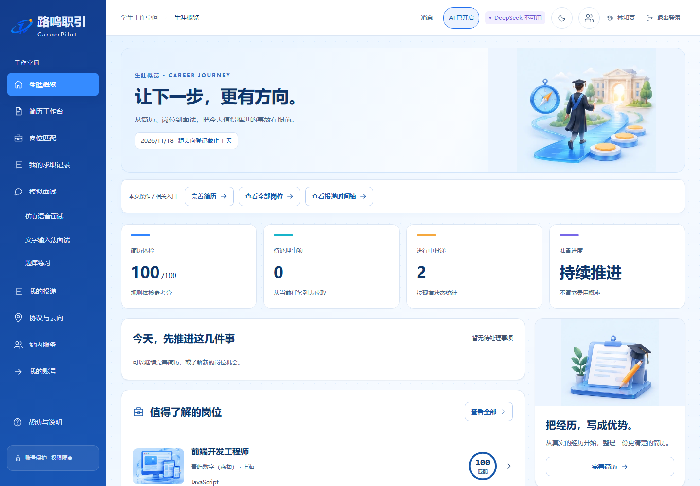

**讲述重点：** 协议、去向、面试是不同实体，不把它们伪装成一条万能状态链；模拟面试不会直接推动真实招聘状态。

### P04｜总体架构：表现、业务、数据与AI分层

**本页目的：** 说明系统怎样组织以及技术选型的理由。45秒。

**可直接上屏文案：**

- 展示层：Vue 3＋TypeScript＋Router＋Pinia；响应式界面与ECharts。
- 服务/领域层：作用域查询、命令、状态迁移、匹配、统计和AI守卫。
- 在线基础设施：Node/TypeScript＋同源HTTP/SSE＋SQLite；服务端调用DeepSeek。
- 独立教学路径：IndexedDB/Dexie；不和在线库混用。

**架构图制作内容：**

```text
浏览器：Vue页面 / 组件 / Router / Pinia
          │ 调用服务接口                │ Web Worker匹配
          ▼                            ▼
app-services / Repository边界     纯TS匹配算法
          │
   ┌──────┴───────────┐
在线HTTP适配       显式离线适配
   │                 │
Node服务           Dexie / IndexedDB
会话与权限         教学数据（独立）
   │
业务事务 / 状态机 ──→ SQLite
   │
AI代理 / 上下文 / 校验 ──→ DeepSeek API
```

图用PowerPoint原生矩形和连接线重绘，最多三层，不用微服务、分布式集群或RAG图标，因为没有这类已实现架构。FastAPI只在附录解释历史本机网关。

**关键代码：** C01说明在线/离线在统一仓储边界选择；主讲仅指出 `isOnline` 和 `createHttpRepository`。如需要投影放大，C01放附录A1，主页面以架构图为主。

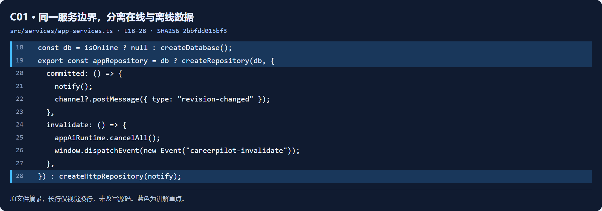

**来源：** `src/services/app-services.ts`；`server/app.ts`第92–111行；`server/database.ts`第112–128行。

**讲述重点：** 选Vue组织复杂页面，纯TS领域便于独立测试，同源服务统一管理会话、数据和上游密钥。转场：“分层的价值，首先体现在数据不会被随意修改。”

### P05｜关键代码①：一次操作，不重复、不越权

**本页目的：** 证明业务可靠性，不把安全仅说成“有登录”。40秒。

**可直接上屏文案：**

- `commandId`＋内容指纹：同一请求重放返回原结果；不同内容复用ID则拒绝。
- `expectedRevision`：旧页面不能静默覆盖新版本。
- 角色/归属校验＋事务：只办理合法业务动作。

**版式：** C02占画面约84%宽，上方一句结论，下方三个短标注分别连接到287、290–294、300–308行。此图25行，投影不清时仅显示重点区域放大，完整图保留附录。不要再并排放第二张代码。

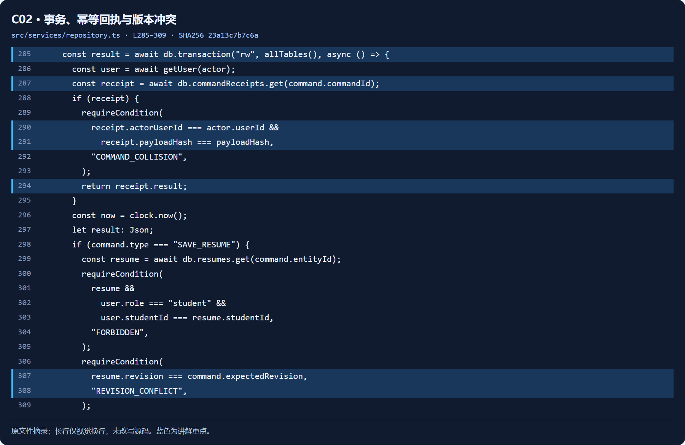

**真实代码：** `src/services/repository.ts`第285–309行。该仓储同时被在线服务复用，在线事务通过SQLite适配执行；不是说当前账号数据仍只存浏览器。

**配套细节：** 状态机C14第75–88行；`server/app.ts`的HttpOnly会话和CSRF检查；`server/database.ts`的BEGIN IMMEDIATE/COMMIT/ROLLBACK。主讲不展开密码学细节。

**讲述重点：** “点两次”和“两个人修改同一版本”是不同问题，分别由幂等与revision处理。转场：“同样，岗位推荐里的数值也要可解释。”

### P06｜关键代码②：岗位匹配，可解释且不卡界面

**本页目的：** 展示算法与异步前端，而不是只展示一个100分圆圈。45秒。

**可直接上屏文案：**

- 六维：技能、专业、学历、城市、薪资、经验。
- 规则分：`round1(100 × Σ维度得分 × 归一化权重)`。
- Worker处理批量计算；取消旧任务，避免过期结果影响当前操作。
- 规则分与AI推荐顺序分开，均不等于录用概率。

**版式：** C03大图占上半至中部；下方用原生六段条表示维度，不编造新结果。侧边仅放“Worker→结果→解释”短链。U13抽屉作附录证据，不将100条岗位长页缩进本页。

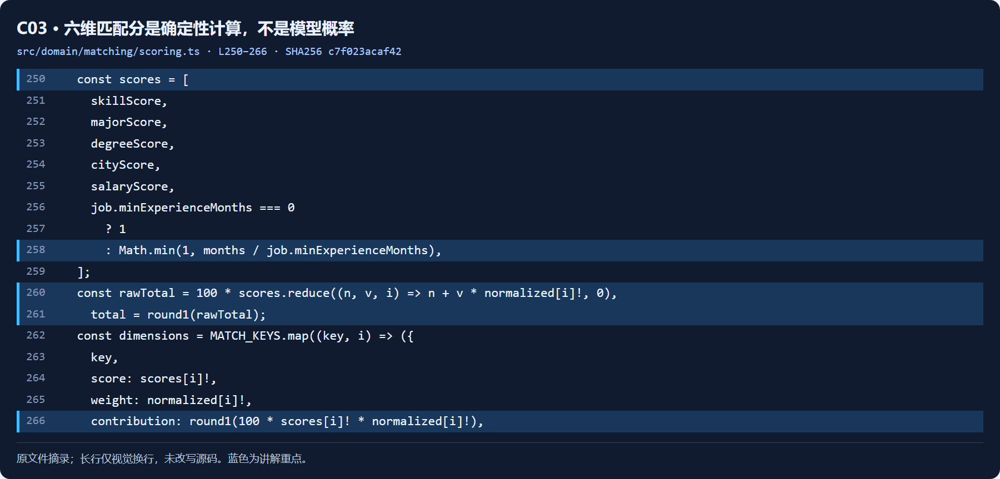

**代码：** `src/domain/matching/scoring.ts`第250–266行，是当前 `match` 路径的实际计算片段，不只是未使用的工具函数。默认权重为0.35、0.20、0.10、0.15、0.10、0.10；允许调整并归一化，未知条件按程序的明确规则处理，不宣称科学预测就业结果。

**Worker证据：** C04，`src/services/matching-worker.ts`第26–43行。性能可在答辩时引用本机100岗30次样本的回归结果，不能说公网全量岗位都只需几毫秒。

**讲述重点：** 规则层提供稳定参照，AI层提供语言解释与建议排序。转场：“接下来才是AI如何安全地接入。”

### P07｜AI接入：服务端代理，不把模型当业务核心

**本页目的：** 全篇技术重点之一。60秒。

**可直接上屏文案：**

1. 页面显式触发→服务端校验会话、授权与数据归属。
2. 服务端重建必要上下文→脱敏/最小化→调用DeepSeek。
3. 解析＋结构/语义校验→记录来源凭据→展示建议。

**强调句：** 密钥不进入浏览器；AI不直接投递、签约或审批；失败不伪造成功。

**版式：** 上方4节点调用链；中部C05大图；下方“凭据：模型/时间/traceId/实际上游ID与用量”。只对实际返回的ID和tokens做记录，不将平台traceId等同于供应商凭据。

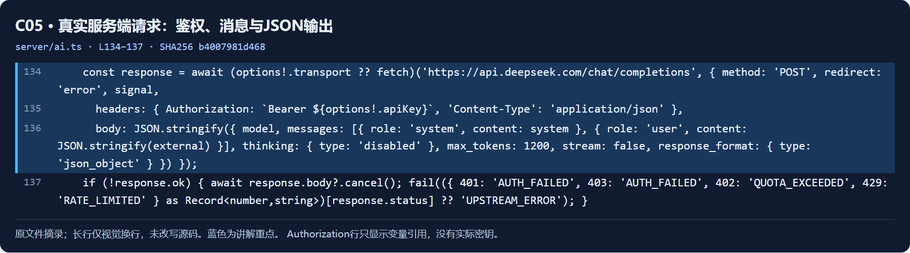

**代码重点：** `server/ai.ts`第134–137行：固定HTTPS上游、Bearer变量、system/user消息、`max_tokens`、`response_format: json_object`及状态码映射。截图不含任何真实密钥，不打开环境文件或开发者网络面板。

**补充说明：** C06第143–149行证明拿到JSON后仍执行 `guardPayload`；工作台另一条路径用 `provider.json`＋任务专用结构和语义检查，不能说所有请求都使用同一套Ajv schema。C12表明调用前有次数与并发限制，次数额度不等于金额预算。

**官方参考：** 已读取2026-11-18官方聊天API、JSON Output及四类工具说明，项目的 `deepseek-flash` 与Search/TTS/ASR/OCR端点均有对应。精确引用以 `deepseek_research.facts.json` 和来源说明为准。文档证明协议存在，不等于本轮已经真实调用或已验收供应商全部能力。

**讲述重点：** 模型是可失败的外部依赖，提示词不是唯一防线。默认授权开关当前按用户要求开启，但进入页面不自动付费；业务保存和投递仍需要人的明确动作。转场：“这个边界，在简历优化中最直观。”

### P08｜AI应用①：优化表达，但保留事实和选择权

**本页目的：** 展示提示词、数据约束、人工采纳如何合成可用功能。45秒。

**可直接上屏文案：**

- 输入：已保存的项目/实习描述，必要字段最小化并脱敏。
- 输出：`before / after / reason / requiresUserInput`建议补丁。
- 校验：原文一致、目标有效、无重复、新增数字拦截。
- 操作：采纳到草稿→核对/撤销→明确保存新版本。

**版式：** 上部C07占90%宽；下部U04以较小局部说明“生成/草稿/确认保存”的不同按钮。不要并排挤代码；必要时通过一次出现动画切换到U04，讲稿时间不增加。

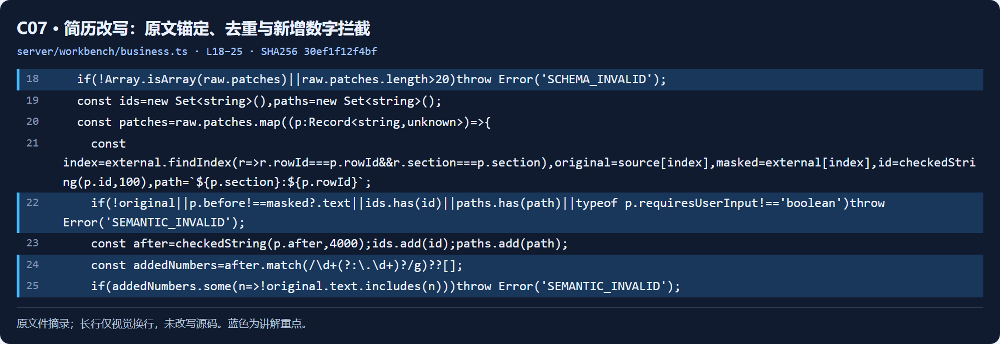

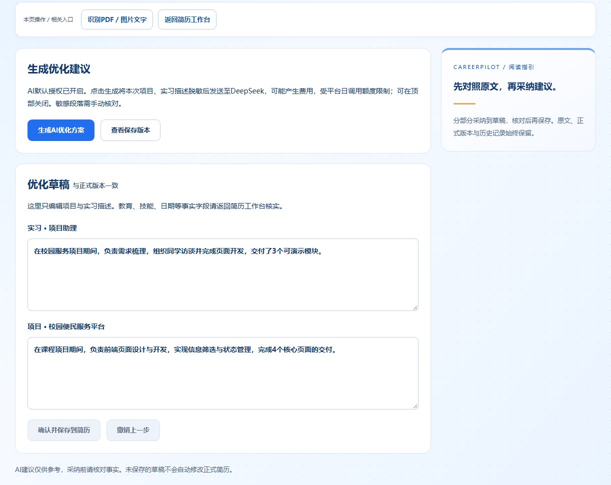

**代码：** `server/workbench/business.ts`第18–25行。第15–17行和26–29行另有脱敏、提示词及可能新增事实的提示判断。不要声称正则能完全消除模型幻觉；合理表述是“多层检查拦截一部分风险，最终仍需人工核对”。

**图注：** U04是未生成状态的真实页面，隔离环境显示上游不可用；它证明草稿/保存机制和布局，不证明真实AI成功生成。模型调用成功与失败以历史独立探测记录作证，不P图伪造结果。

**讲述重点：** AI输出是建议，不是正式简历；事实不能被为了好看而创造。转场：“对面试，系统还必须处理等待与失败。”

### P09｜AI应用②：面试、语音与流式交互

**本页目的：** 展示异步流程与失败体验设计。50秒。

**可直接上屏文案：**

- 文本面试：岗位＋历史回答→首题/追问→带引用的逐轮评价。
- 语音链：TTS播题→录音→整段ASR→核对转写→提交回答。
- 稳定性：回答先持久化；生成失败不丢回答、不虚构0分。
- 助手：SSE增量展示＋取消＋历史；不代办业务。

**版式：** C08居中占90%宽；顶部仅放“先保存→再生成→可恢复”三个节点；语音链作为底部一行。C09、C10作为追问时的大图附录，不在50秒内展示三张代码。

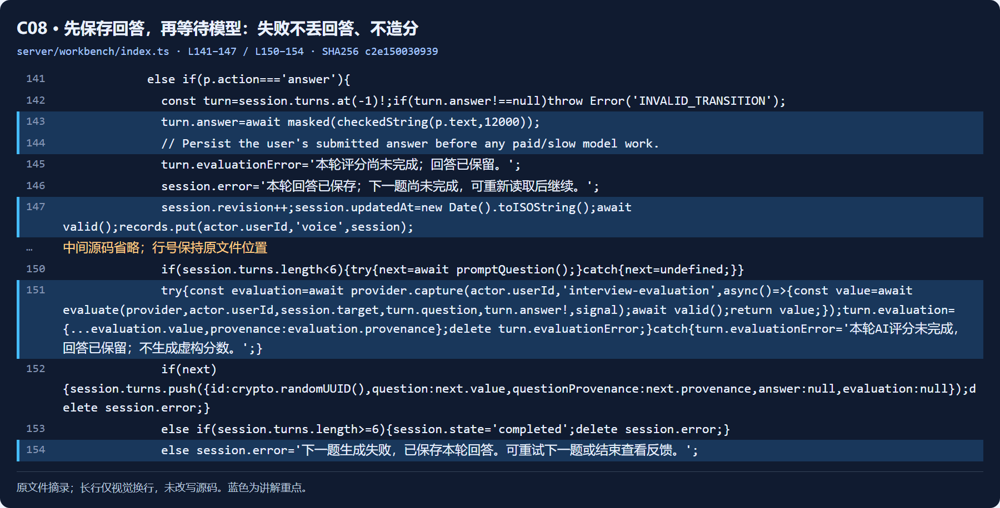

**代码：** `server/workbench/index.ts`第141–147、150–154行；中间148–149行明确标记省略，代码原行号保持。模型评价需引用回答中的片段，合法得分按有效维度汇总；综合报告平均有效评价，不把未完成轮次计0分。

**语音边界：** ASR为16kHz单声道16bit整段WAV，最长120秒/8MiB；TTS返回24kHz PCM。不是实时双工语音，也没有声纹或表情识别能力。文字模式不自动调用TTS/ASR，麦克风要浏览器授权。SSE是文本结果流，不等于ASR流式识别。

**讲述重点：** 对用户最重要的不是“有没有AI按钮”，而是网络慢或失败时，刚才的回答还在。转场：“技术边界也体现在界面如何引导操作。”

### P10｜界面工程：统一语言，不等于复制页面

**本页目的：** 说明前端完成度和AI辅助设计，但不将素材生成混同业务AI。30秒。

**可直接上屏文案：**

- 统一：品牌、字阶、按钮、导航、弹窗、空/错/加载状态。
- 差异：概览、题库、编辑器、招聘流程和驾驶舱各有页面结构。
- 适配：明暗主题、窄屏重排、装饰图层与操作区分离。
- 开发辅助AI：Codex辅助实现与测试；gpt-image-2.6制作插画资源。

**版式：** U05题库占左侧65%，U11窄屏占右侧22%；U12暗色局部可替换出现。避免同时塞三张长截图。配图来自现有应用资源，不在本轮重新生图。


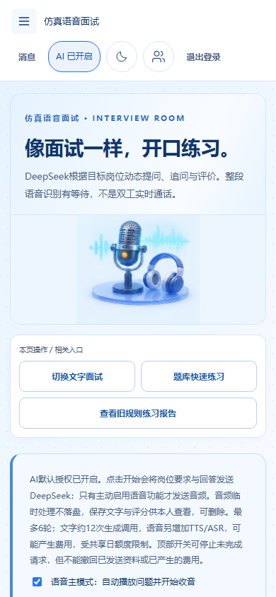

**实现依据：** C11页头槽位分离标题、装饰图与动作入口；`src/styles/workbench-design.css`设置页面族、主题和布局；`src/styles/workbench-windows.css`处理窗口；图片为装饰时 `aria-hidden` 和空alt避免重复朗读。应用实时文字和按钮是Vue原生控件，不是整张效果图热点。

**AI说明：** 业务AI是DeepSeek接口；图片生产工具是Nebula/gpt-image-2.6；Codex是开发辅助。三者分别说明，不虚构“本项目训练了大模型”，也不声称已完成Figma Code Connect。

### P11｜使用方法：沿一条真实任务链操作

**本页目的：** 45秒内告诉用户如何使用，不现场从安装到注册。

**可直接上屏文案：**

```text
登录已审核账号
  → 学生：完善并保存简历
  → 岗位：筛选 / 规则依据 / AI建议
  → 求职：确认投递 / 查看时间轴
  → 面试：选择文字或语音 / 核对 / 提交 / 查看反馈
  → 企业与学校：候选推进 / 日程 / 去向审核 / 驾驶舱
```

**演示安排：** 优先使用静态连续截图或排练后的短录屏，而非临时等待付费API。建议U02概览8秒→U03岗位12秒→U06面试10秒→U08企业日程/U09驾驶舱15秒。仅做说明，不在真实数据中创建投递、协议或审核记录。

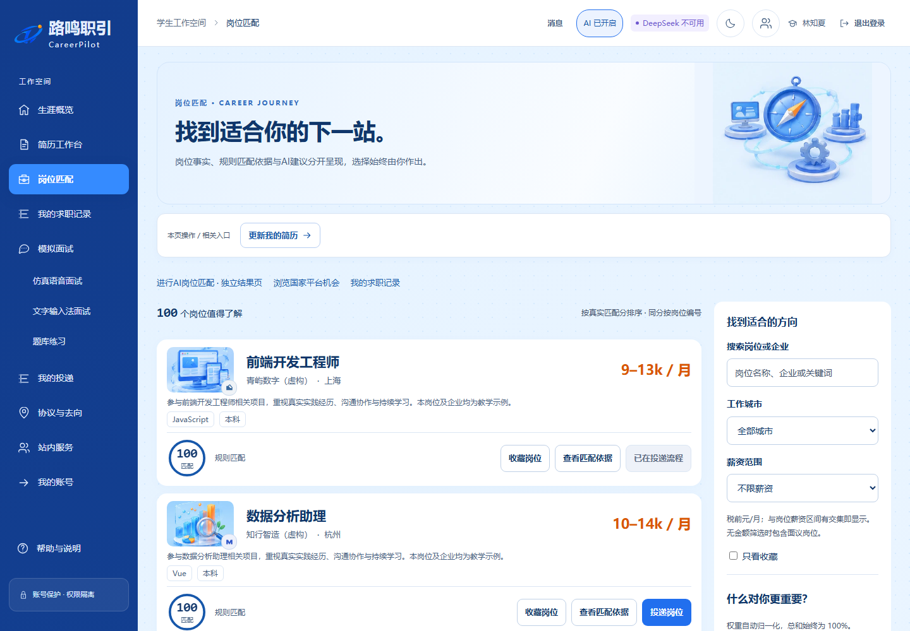

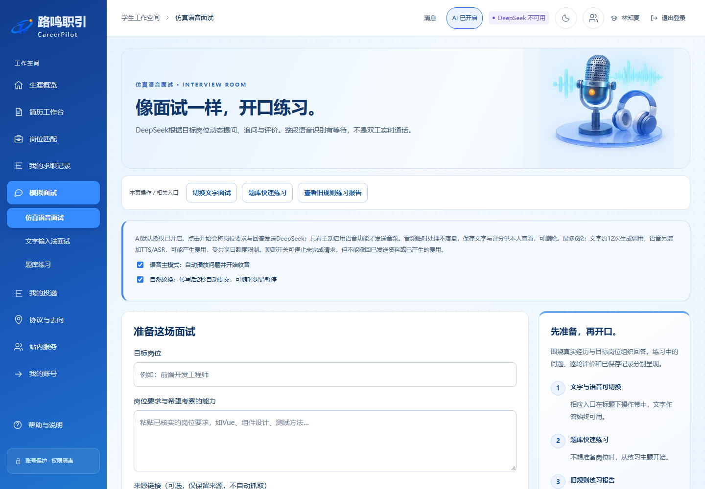

**具体使用说明（可转讲义，不全部放上屏）：**

1. 已构建且已初始化的环境，在项目目录使用 `npm start` 或 `start-service.cmd`，访问4174；现有数据不要再次初始化。首次部署另按README安装依赖、构建和受控初始化，不在现场进行。
2. 登录approved账号；学生/企业新注册需要审核，不冒充注册即获得全部权限。
3. 简历工作台填写事实并保存；生成优化建议可能外发必要内容、产生费用；先核对草稿，再保存新版本。OCR会发送整份文件，不能宣称图片已经可靠脱敏。
4. 岗位页先查看条件与规则依据。AI岗位匹配需要显式点击；外部公开机会在原站核验和办理，不等同站内企业岗位。
5. 面试选题或指定岗位；文字可直接提交，语音先授权麦克风并核对转写。失败可保留回答继续，不伪造报告。
6. 企业和辅导员使用自己的角色入口，不在正式库随意改状态。所有撤销/签约/审核保留原业务确认。

**现场预案：** 页面事先打开；备好本素材包；不展示账号密码、环境文件、密钥管理窗口与完整网络请求头；若AI不可用，明确说不可用，切到代码与已有证据，不自动重试。

### P12｜验证与总结：有证据，也有明确边界

**本页目的：** 用有限而可靠的证据结束，25秒。

**可直接上屏文案：**

- 已实现：四角色业务闭环、确定性匹配/统计、AI工作台、图文界面。
- 最新UI补验：Chromium/Edge主要页面与关键流程；窗口复验26/26、性能专项6/6。
- 历史真实AI：合成材料下有完整11环节成功探测，也保留失败记录。
- 边界：本机候选版；不宣称公网、真人语音、生产负载全部验收。

**收束句：** 让业务可追踪，让建议可核查，让下一步可行动。

**版式：** 左侧“业务/技术/体验”三点总结，右侧一张验收卡；卡片必须标注验证日期和范围，不能只写大大的“100%”。底部保留一句边界。主讲无需朗读所有测试数字。

**证据解释：** 最新主要UI首轮114项中112通过，2项测试读取布局帧的问题修正后相关26项复验通过；不是“114项首次全部通过”。未重跑全量543单测/276E2E。既往严格AI整套516单测与158功能E2E属于11月15日阶段，不合并成这次最新测试数。性能是本机本地环境，非公网。

**真实AI证据：** `sources/evidence/strict-ai-pet-live.json`记录累计38次请求尝试、8次显式探测运行（历史记录、无自动重试），其中 `xdxr4b` 11环节全部成功；其他记录含语义拒绝等失败。它们是历史合成材料烟测，不是本轮现场真人全链路通过。外部API官方支持情况另按核验结果说明。

## 五、备用附录与答辩准备

### AI能力与实现边界速查（讲义/问答用）

| 能力 | 真实触发与程序机制 | 不应夸大的边界 |
| --- | --- | --- |
| A1表达建议 | 保存版本/选定字段→prepare/confirm→JSON及引用守卫→待采纳建议 | 不自动改正式简历 |
| 简历优化 | 项目/实习必要文本→建议补丁→人工草稿/撤销/保存新版本 | 不自动补造教育、技能、日期或业绩 |
| 规则匹配＋AI推荐 | 六维规则独立计算；模型对最多30个真实候选给出最多15项排序与理由 | 不编造候选；未知条件不是已满足；非录用概率 |
| A3岗位解释 | 当前岗位与规则事实→结构/语义守卫→解释 | 模型文本不能重算事实分 |
| 动态文字/语音面试 | 首题/追问/评价；回答先保存；合法引用与数值；有效评价汇总 | 练习评分非能力认证；文本模式不自动发语音请求 |
| A7问数/帮扶 | 权限内确定性指标与匿名上下文→模型语言解释/建议 | 不让模型制造统计事实，不直接执行帮扶/审核 |
| 全局助手 | 当前页面/角色/权限内必要摘要→SSE→历史与取消 | 不假装读取未提供的全文，不执行投递/审批/保存 |
| Search | 用户明确触发的公开发现，结果引用来源 | 搜索结果不自动变成已审核站内岗位 |
| OCR | 单次PDF/PNG/JPEG≤2MiB、PDF≤20页，整份文件外发并逐页展示 | 不认证证书，不保证图片自动脱敏，不自动写简历 |
| ASR/TTS | 音频授权、整段WAV转写、PCM播题，允许改用文字 | 非流式ASR、非实时双工；真人听感/设备另验 |

这张表可拆为附录，但不加入主讲12页，不因列出更多能力而压缩关键代码讲解时间。

附录不作为第13页起的必讲内容。建议制作3–4页，提问时跳转；本设计包提供更完整素材，正式制作时按问题选择。

| 附录 | 内容 | 素材 |
| --- | --- | --- |
| A1 架构与数据 | 在线/离线边界、状态机、事务和版本 | C01/C14；数据库事务源码 |
| A2 算法与交互 | 实际六维计算、Worker取消与规则抽屉 | C03/C04/U13 |
| A3 AI可信度 | JSON解析和守卫、次数限制、脱敏范围 | C06/C12/C13 |
| A4 AI面试/体验 | 评价引用、有效维度均值、SSE完整结束 | C09/C10 |
| A5 界面与引用 | 组件页头、暗色/窄屏、官方文档和许可 | C11/U11/U12；来源说明 |

推荐追问与回答：

**“AI是自己训练的吗？”** 不是。项目调用外部DeepSeek服务；自行实现的是任务编排、上下文、权限、校验、结果采纳和业务集成，没有自训练模型或RAG训练成果。

**“为什么不能把AI结果直接保存？”** 内容可能错误或过时，因此生成绑定来源版本，人工核对后再以业务命令保存；事务、revision和角色归属是正式数据的最后边界。

**“匹配100分是否一定能录用？”** 不是。它是六维规则下的参考结果；AI排序同样只是建议，不是录用概率或专业能力认证。

**“AI对话是不是实时语音？”** 文本助手为SSE增量；语音面试是整段ASR/TTS与串行提问评价，不是实时双工，也不分析口音或声纹。

**“为什么截图中AI不可用？”** 这些是隔离后端、不带真实密钥的UI验收截图；不会为了截图让真实用户资料外发。真实上游探测在历史安全元数据中单列，失败同样保留。

**“这个已经能公网运行了吗？”** 当前已验证本机HTTP账号版与持久化，不等于TLS、生产容量、备份运营、真人身份和公网安全全部放行。

**“开发中使用AI是否等于没有技术工作？”** AI辅助了候选代码、排错与素材设计；项目的工程价值在于把需求变成可测的边界、可追踪的数据和可恢复的交互。展示真实源码、守卫和失败证据，而非把工具生成物包装成自主模型研发。

## 六、开发阶段如何在展示中体现

无需为每个阶段单独做一页；在P04下方用5个短节点表示演进，详细放讲义：

1. 基础阶段：需求/契约、Vue工程、组件与领域模型。
2. 业务阶段：确定性算法、学生主链、四角色和治理端。
3. 在线阶段：Node/SQLite、账号会话、审核准入、持久化和公开机会源。
4. AI阶段：同源AI工作台、严格LIVE、简历建议、推荐、动态面试、语音/OCR及来源记录。
5. 收官阶段：全站图文组件升级、窗口/状态与主要界面补验。

来源是开发记录、README顶部现状、各阶段evidence与当前源码。不可变baseline描述“计划”，旧报告描述“当时完成”，不把它们混成今天的架构；文档冲突处理见来源说明。

## 七、制作与排练验收清单

- 页面含背景、概要、技术、使用方法四类要求；重点代码至少C02/C03/C05/C07/C08清晰上屏。
- 不用概念图冒充运行截图，不用AI生图重画代码，不修改代码含义；截图中的行号、source SHA256可核对。
- 主讲12页，时间460秒；附录不朗读。讲稿计量仅是估计，不能冒充真人排练结果。
- 代码只讲蓝色重点行，不逐字符念长URL/正则/类型声明。
- 屏幕截图不得展示真实密码、Cookie、Token、环境文件和私人材料。
- 所有模型、API、性能与测试范围注明来源；官方文档未证实之处不写成确定官方能力。
- 静态截图预案可用；不依赖现场注册、安装、初始化、联网和余额。
- 成品制作时再走PPT Master正式确认与导出流程；本轮不越过确认门禁生成PPTX。

配套文件：`02-报告演讲稿.md`、`03-事实来源与素材说明.md`、`素材清单.json`、`images/`、`sources/code/`、`阅读版.html`。
